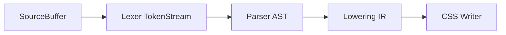

# Lexer and parser redesign

Replace space-splitting word chopping with a real token stream (kind + source span), then a recursive-descent parser that builds a tree of typed AST nodes. Keep later features (Tailwind, regex, snippets) as later lowering passes so the core stays small as the language grows.

## Typed tokens vs raw words

**Yes — typed tokens are the correct next step.** The current lexer in [`main/lexer.h`](main/lexer.h) only collapses spaces and stores `char tokens[MAXTOKENCHAR][MAXTOKENS]` strings. That cannot drive a parser: `width: 100%` stays glued, commas ride on identifiers (`padding,`), `def :hover / color = black` is undifferentiated word soup, and indent is smuggled as `tokens[0][0]`.

Keep **three layers**, not one:

| Layer | What it knows | Example |
| --- | --- | --- |
| Lexer `Token` | Lexical kind + slice of source | `IDENT("color")`, `COLON`, `EQUALS` |
| Parser `AstNode` | Syntactic role | Property `color` with value `--main-color` |
| Lowering / writer | CSS meaning | Nesting flattened, Tailwind expanded, `var()` emitted |

Do **not** have the lexer label tokens as “property” vs “selector”. `color` is an identifier until the parser sees `color:` vs `def color`. The parser links **token kind + lexeme** into an AST node that also holds a **source span** for errors.



---

## What is wrong today

Pipeline in [`pyss.c`](pyss.c): read a line → `lex()` → print strings. [`main/parser.h`](main/parser.h) is empty; [`main/writer.h`](main/writer.h) is never called.

[`main/data.h`](main/data.h) has a **single global** `NODE` (`type`/`name`/`value` as strings). Nested `def` in the README cannot be a tree. Writer compares `node.type` with `"selector"` / `"property"` — that should be an enum on AST nodes, not a string.

Other lexer issues to drop in the rewrite: `strip()` mutates the line and duplicates the `(` handler (the “brackets” branch is a copy of parens); comments `//` are not skipped; indent counting is space-hacked; diagnostics globals are scattered.

---

## Target data model

**Source** — load the whole file once. Tokens never copy text; they point into this buffer.

```c
typedef struct Span {
    uint32_t start, length; /* byte offsets */
    uint32_t line, column;  /* 1-based for errors */
} Span;

typedef struct Source {
    const char *path;
    char *bytes;
    size_t size;
} Source;
```

**Tokens** — growable array, not a 2D `char[][]`.

```c
typedef enum TokenKind {
    TOK_EOF, TOK_NEWLINE, TOK_INDENT, TOK_DEDENT,
    TOK_IDENT, TOK_NUMBER, TOK_STRING, TOK_HASH, /* #FFFFFF */
    TOK_COLON, TOK_EQUALS, TOK_COMMA, TOK_SLASH,
    TOK_DOT, TOK_STAR, TOK_LPAREN, TOK_RPAREN,
    TOK_KW_DEF, TOK_KW_APPLY, TOK_KW_USE,
    /* add punctuation here as syntax grows; do not add "property" */
} TokenKind;

typedef struct Token {
    TokenKind kind;
    Span span;
} Token;
```

Keywords (`def`, `apply`, `use`) are recognized in the lexer after scanning an identifier (small keyword table). Everything else stays `TOK_IDENT` (selectors, property names, Tailwind class names, `--vars`).

Emit **INDENT / DEDENT / NEWLINE** like Python so nesting is explicit for the parser. Skip `//` comments (optionally keep a `TOK_COMMENT` only if you later want CSS comment passthrough).

**AST** — tree, not one global node. Each node stores kind, span, and **indices into the token array** (or child lists), not duplicated strings.

```c
typedef enum AstKind {
    AST_STYLESHEET,
    AST_RULE,          /* def selector [body | / inline] */
    AST_PROPERTY,      /* name : value   or   name = value */
    AST_PROP_GROUP,    /* a, b, c = value */
    AST_APPLY,         /* apply class class ... */
    AST_USE,           /* use class */
} AstKind;

typedef struct AstNode {
    AstKind kind;
    Span span;
    uint32_t token_from, token_to; /* slice of Token[] */
    struct AstNode **kids;
    size_t kid_count;
} AstNode;
```

The parser’s job: “this `IDENT` is a property name because a `:` or `=` follows; this `IDENT` is a selector because it follows `def`.” That **is** displaying types as property/rule — at AST dump time, not at lexer dump time.

Debug prints:

- Lexer dump: `IDENT(color) COLON IDENT(--main-color) NEWLINE`
- Parser dump: `Property name=color value=--main-color span=file:21:9`

---

## Grammar to freeze first

Put a short EBNF in [`rules/grammar.md`](rules/grammar.md). Start with README/prototype syntax only:

```
stylesheet  := { statement }
statement   := comment | rule | NEWLINE
rule        := INDENT* "def" selector ( NEWLINE INDENT body DEDENT | "/" inline )
body        := { property | apply | use | rule | NEWLINE }
property    := names (":" | "=") value NEWLINE
names       := ident { "," ident }
apply/use   := ("apply" | "use") ident { ident } NEWLINE
selector    := ident | "*" | "." ident | ":" ident | ...
inline      := property   /* def :hover / color = black */
```

`:` vs `=` can mean the same assignment for v1 (README uses both). Hex `#FFFFFF/FF` is lexer: `HASH` then optional `SLASH` + hex ident, or one `TOK_HASH` that eats `/alpha`.

Leave **regex property calling**, **snippets**, **breakpoints** out of v1 grammar; they become new token kinds + AST kinds later without rewriting the pipeline.

---

## Architecture as it grows

Stop implementing logic inside headers included from [`pyss.c`](pyss.c). Split:

- [`main/source.h`](main/source.h) / `source.c` — load file, spans, `lexeme(source, token)`
- [`main/token.h`](main/token.h) — `TokenKind`, `Token`, `token_kind_name()`
- [`main/lexer.h`](main/lexer.h) / `lexer.c` — `lex_file(Source*) -> TokenBuf`
- [`main/ast.h`](main/ast.h) — `AstKind`, `AstNode`, dump helpers
- [`main/parser.h`](main/parser.h) / `parser.c` — recursive descent on token index
- [`main/error.h`](main/error.h) — keep the existing pretty printer; feed it `Span` + original line from `Source` (drop hardcoded `"style.pyss"`)
- [`main/lower.h`](main/lower.h) later — flatten nesting, `var()`, Tailwind
- [`main/writer.h`](main/writer.h) — walk **lowered** tree only
- [`pyss.c`](pyss.c) — CLI: load → lex → parse → lower → write

**Rule for growth:** new punctuation → lexer enum value; new statement shape → parser function + `AstKind`; new CSS behavior → lowering pass. Never teach the lexer about Tailwind or nesting.

Fixed-size arrays are fine until they are not: start with a reallocating `Token` vector and an AST arena (bump allocator or `malloc` per node). Do not bring back `MAXTOKENS`.

---

## Implementation phases

### Phase 1 — Source + real lexer (no parser yet)

- Load whole file; scan char-by-char: idents (`[A-Za-z_][A-Za-z0-9_-]*` plus CSS-ish `--foo`, `.class` as `DOT`+`IDENT` — prefer separate `DOT` / `STAR` / `COLON` so `:hover` is `COLON IDENT`), numbers, strings, `#hex`, punctuation, newlines.
- Track column **before** any stripping; never mutate source.
- Indent stack → `INDENT`/`DEDENT`.
- Dump tokens for [`rules/prototype.pyss`](rules/prototype.pyss) until that file tokenizes cleanly.
- Keep current error style (`LexerError` + caret) but keyed off `Span`.

### Phase 2 — Parser → AST

- Recursive descent: `parse_stylesheet`, `parse_rule`, `parse_property`, `parse_apply`.
- Indentation: consume `INDENT`/`DEDENT` rather than counting spaces in the parser.
- AST dump of prototype: nested `Rule(header)` containing `Apply`, `Property`, nested `Rule(.logo)`, inline `Rule(:hover)`.
- Parser errors: unexpected token, missing value, indent mismatch — reuse [`error.h`](main/error.h) with parser codes in [`rules/main.error.h.codes..md`](rules/main.error.h.codes..md).

### Phase 3 — Wire writer to AST (minimal CSS)

- Flatten nesting: `header` + `.logo` → `header .logo`; `def :hover` under `.logo` → `header .logo:hover`.
- Emit properties; map `=` and `:` to `prop: value;`.
- `--name` values → `var(--name)` at write/lower time, not in the lexer.
- `apply`/`use` can emit a comment or pass classes through until Tailwind exists.

### Phase 4 — Language extras as separate passes

- Tailwind tables / `apply` expansion
- Property grouping already in AST (`AST_PROP_GROUP`) → duplicate CSS properties
- Snippets, regex selectors, breakpoints

### Phase 5 — Housekeeping

- CLI: `pyss input.pyss -o out.css` (remove hardcoded Windows/Linux test paths)
- Small golden tests: tokenize / parse / emit `prototype.pyss`

---

## What not to do

- Classify “property” in the lexer.
- Parse by splitting on spaces or comparing `tokens[i]` strings.
- One global `NODE`; stringly `type` fields.
- Fold Tailwind into `lex()`.
- Implement regex/snippets before the prototype file round-trips through lex → parse → CSS.
